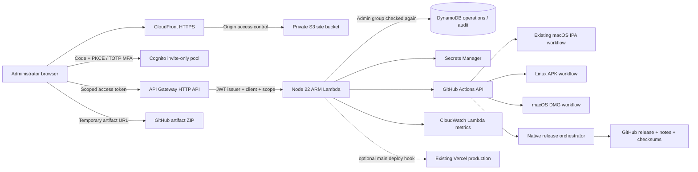

# Architecture and operations

## Trust boundaries

The static JavaScript is public; it contains no integration secret. Private access is enforced by the API, not by hiding the dashboard URL. Cognito self-signup is disabled, TOTP MFA is mandatory, and only accounts in `admins` are accepted. The SPA uses authorization-code PKCE, one-use state, and a public app client with no client secret. Access tokens expire after 30 minutes and are stored only in browser `sessionStorage`; no silent refresh token is retained. Sign in again when the session expires. JavaScript-accessible storage still makes XSS prevention important.

API Gateway checks the JWT signature, issuer, audience/client, expiry, and `twilight-admin/control` scope. Lambda also checks `token_use=access`, the `admins` group, and origin when supplied. CORS allows only the deployed CloudFront origin. CORS is not authentication. Admin removal/revocation may take until an issued JWT expires to be effective at API Gateway. For an urgent lockout, disable the API/Lambda and revoke the Cognito user; do not rely on group removal alone.

CloudFront reads the private S3 bucket through OAC. Responses include CSP, clickjacking protection, no-referrer, and MIME-sniff protection. The default CloudFront domain uses AWS's default certificate/security policy; a custom domain + ACM certificate is required to select a stricter custom TLS policy. HTTPS redirects are enabled. No custom domain is provisioned automatically.

## Integration credentials

Only Lambda's role can read the stack's integration secret. It has table-scoped DynamoDB read/write permissions, log writing, and CloudWatch `GetMetricData` (AWS requires `Resource: *` for this action). The browser has no AWS IAM permissions. Publishing and admin invitation use your separate local deployment identity.

The GitHub integration supports:

- A GitHub App installation restricted to this repository, with Actions write and Contents read. Lambda signs a short-lived App JWT and caches an installation token until shortly before expiry.
- An expiring, fine-grained PAT restricted to the same repository and permissions. Easier for a personal first deployment; rotate it on expiry.

Secrets are cached for at most 60 seconds per Lambda execution environment. Logs never deliberately include tokens, request bodies, signed artifact URLs, deploy hook URLs, or secret values. Logs contain request ID, error class, and status. AWS logs and DynamoDB audit events contain admin identifiers and operations metadata; restrict access accordingly.

## Mutation rules

- Only `ios-unsigned.yml`, `android-apk.yml`, `macos-dmg.yml`, and the validated `native-release.yml` orchestrator on `main` can be dispatched. The release workflow checks the version/platform list/notes, then builds all selected installers from the same source commit before shipping. See [RELEASES.md](RELEASES.md).
- No browser-supplied ref, workflow name, repository, command, or URL is accepted.
- Schema validation rejects additional input properties and oversized bodies.
- A DynamoDB transaction durably claims each actor/request UUID, records a request event, and checks the pause flag before a build is dispatched. Identical accepted replays return duplicate acceptance. Pending/uncertain attempts are not retried automatically. Different commands cannot reuse a request UUID.
- Network timeouts can occur after GitHub/Vercel accepted an action. Check upstream status before requesting a new action. This is durable duplicate suppression per request ID, not a distributed exactly-once guarantee.
- Artifact download/cancellation re-fetch the run and require the known mobile workflow on main. Expired artifacts are rejected. Download redirects are limited to HTTPS GitHub/Azure artifact hosts.
- Production deployments use an optional secret Vercel hook, configured for main. The backend validates the fixed Vercel host and path; a browser cannot choose another URL.
- Build cancellation is auditable but may be repeated; the provider owns final cancellation state.

## API contract

All routes require a scoped admin access token. JSON responses use `Cache-Control: no-store`.

| Method | Route | Input / output |
|---|---|---|
| GET | `/snapshot` | Latest 100 main runs, latest 100 audit records, pause/config metadata |
| GET | `/metrics` | Last 24 completed UTC hours, displayed in browser local time |
| GET | `/runs/:id` | Run, jobs, step results, mobile artifacts |
| POST | `/builds` | `{platform: "ios", "android", or "dmg", requestId: UUID}` |
| POST | `/releases` | Validated version, notes, unique platform array, publish flag, request UUID |
| POST | `/runs/:id/cancel` | Request cancellation of a mobile run |
| GET | `/artifacts/:id/download` | Short-lived artifact ZIP URL |
| POST | `/deployments` | `{requestId: UUID}`; optional Vercel hook |
| POST | `/settings` | `{paused: boolean}` |

Snapshot data also includes the latest 10 releases visible to the GitHub credential and their notes. GitHub restricts draft listings to identities with push access; the recommended read-only Contents permission may omit drafts. The UI links to GitHub for owner review instead of expanding the integration's source-code write access. Local demo uses the same frontend interface without any network mutation. Production never exposes demo endpoints.

## Latency and cost choices

Parallel independent reads; bounded GitHub fetch timeouts; reused AWS clients; 10-second workflow cache; 60-second metric/secret cache per execution environment. Frontend polls every 15 seconds while visible, avoids overlapping refreshes, and loads no external fonts, analytics, or icon services. No VPC, NAT gateway, load balancer, RDS, EC2, or always-on builder is provisioned.

Lambda is 256 MB ARM with a 25-second timeout and two reserved executions by default. API Gateway throttles to 2 requests/second with burst 5. These protect this small console but are not hard billing limits. The cache is per execution environment, not global; admin pause reads and idempotency use consistent DynamoDB reads/transactions.

Lambda metrics include this console's own polling requests. Duration is execution time, excluding client/network/API Gateway latency. Error count is Lambda's `Errors` metric; handled HTTP 4xx/5xx responses do not count as uncaught Lambda errors. Use request logs to diagnose them. A 3-errors-in-5-minutes alarm optionally sends SNS email. The $10 account-wide monthly budget excludes credits/refunds so it can warn about gross spending even while credits cover charges. Billing alerts can be delayed.

## Future extensions

Add Android CodeBuild with a separate build role and stable signing key when needed. Add immutable release artifacts in S3 with an explicit retention policy and completion ingestion if GitHub retention is insufficient. Add consumer app telemetry only after defining privacy-safe events and consent; never decrypt user vaults in the admin console. Add a narrowly scoped workload shutdown orchestrator only after actual AWS workload resources exist and a precise shutdown/restore plan is defined.
